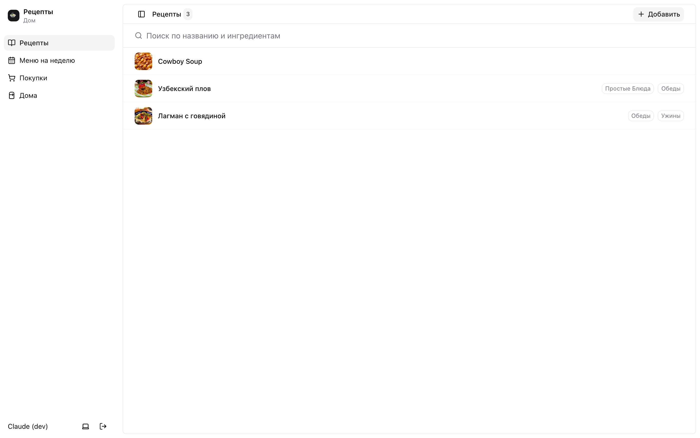
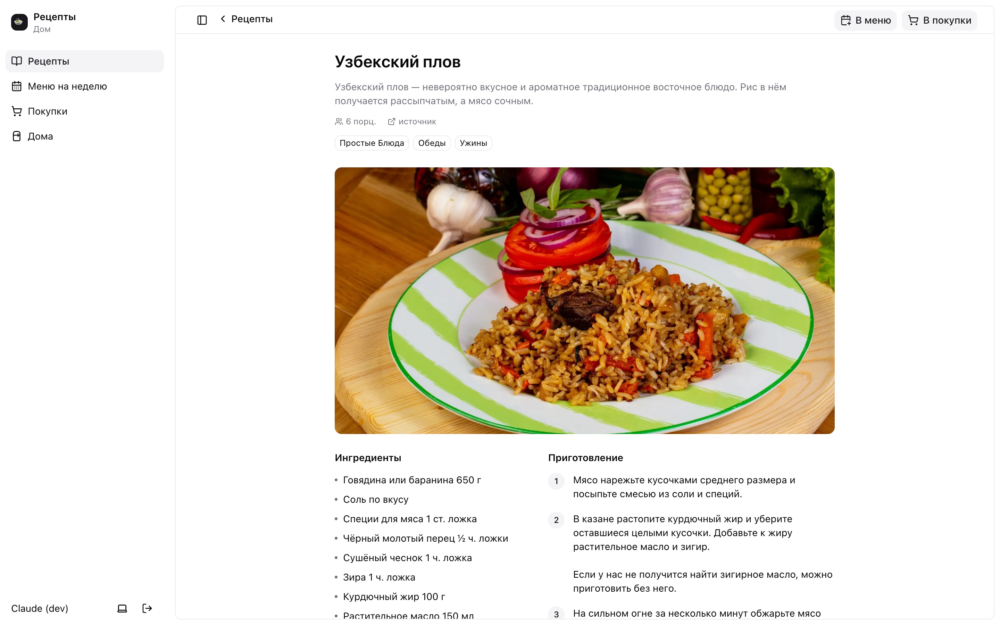
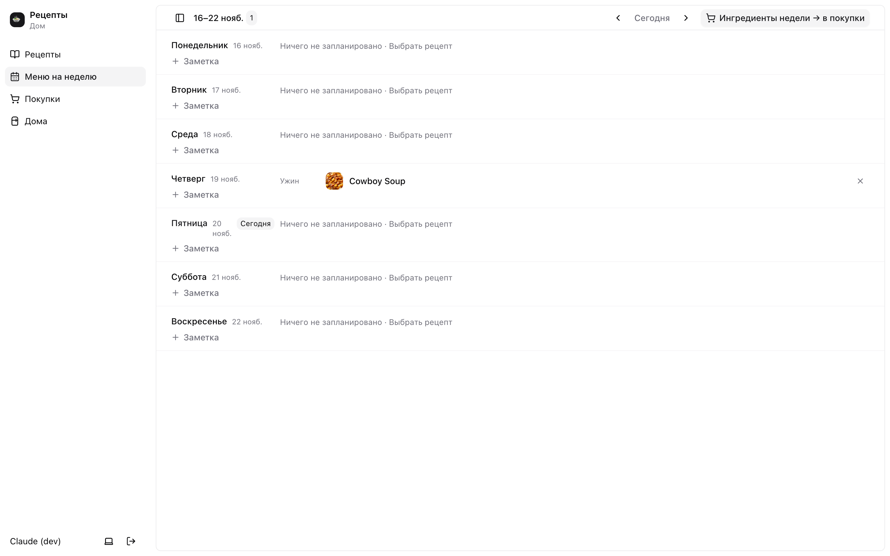
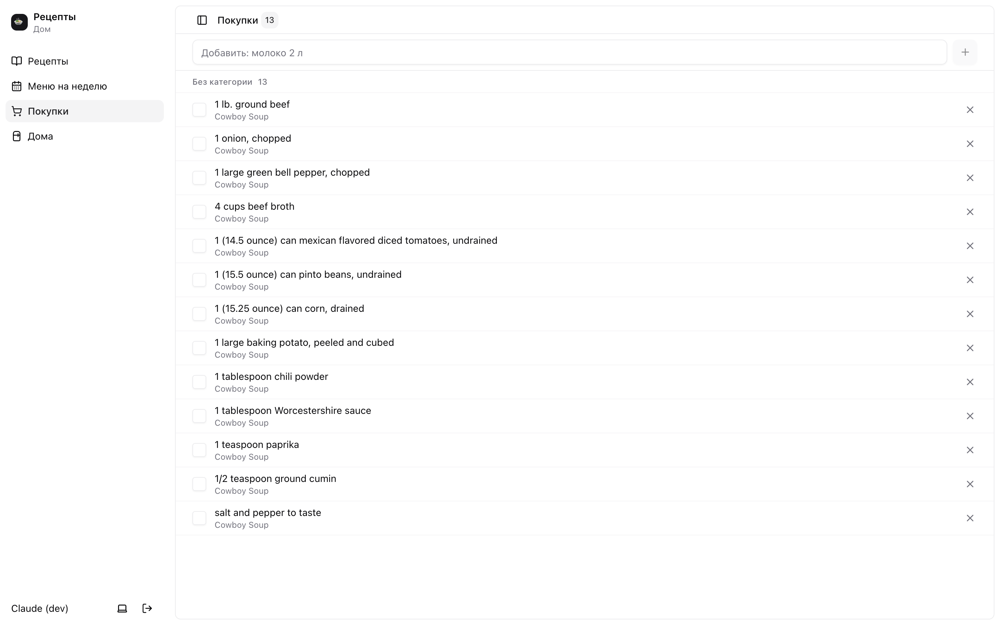
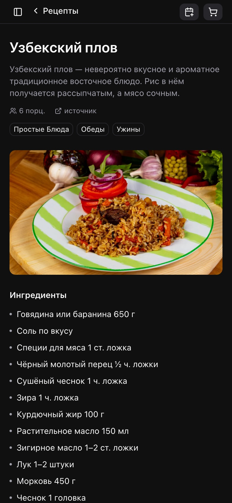
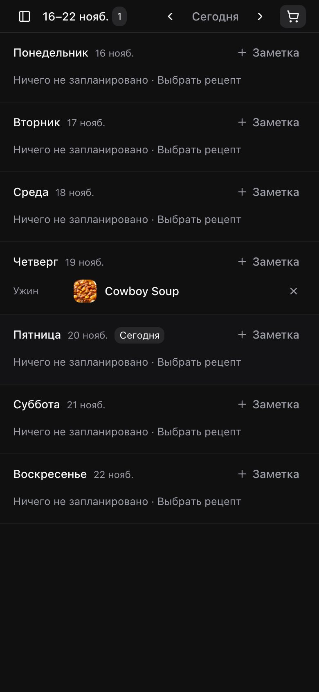
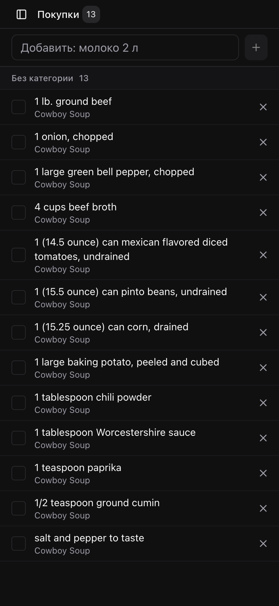

# Рецепты

Домашние рецепты, меню на неделю, список покупок и «что есть дома» для двоих.
Данные и логика живут в [Mealie](https://github.com/mealie-recipes/mealie) на hermes,
этот репозиторий — единственный интерфейс к нему. Устройство описано в
[docs/architecture.md](docs/architecture.md).

<picture>
  <source media="(prefers-color-scheme: dark)" srcset="docs/screenshots/recipes-dark.png">
  
</picture>

## Как это выглядит

Живой сайт: [recipes.magzhan.me](https://recipes.magzhan.me) (вход только для своих).

| Рецепт                                                                                                                                                                           | Меню на неделю                                                                                                                                                                       |
| -------------------------------------------------------------------------------------------------------------------------------------------------------------------------------- | ------------------------------------------------------------------------------------------------------------------------------------------------------------------------------------ |
| <picture><source media="(prefers-color-scheme: dark)" srcset="docs/screenshots/recipe-dark.jpg"></picture>   | <picture><source media="(prefers-color-scheme: dark)" srcset="docs/screenshots/plan-dark.png"></picture>             |
| **Покупки**                                                                                                                                                                      | **Импорт по ссылке**                                                                                                                                                                 |
| <picture><source media="(prefers-color-scheme: dark)" srcset="docs/screenshots/shopping-dark.png"></picture> | Кнопка «Добавить» на странице рецептов: вставляете ссылку на рецепт с любого сайта, Mealie разбирает ингредиенты и шаги. Если в рецепте есть свинина или алкоголь, сайт предупредит. |

С телефона:

<p>
  
  
  
</p>

## Разработка

Нужен туннель к Mealie и `.env.local` (в git не попадает):

```bash
ssh -N -L 9926:127.0.0.1:9925 hermes
```

```text
MEALIE_URL=http://127.0.0.1:9926
```

```bash
npx -y pnpm@9 install
npx -y pnpm@9 dev
```

Вход — логином и паролем пользователя Mealie.

Типы API генерируются из снимка `lib/mealie/openapi.json` (Mealie `v3.31.0`). После
обновления Mealie:

```bash
ssh hermes 'curl -s http://127.0.0.1:9925/openapi.json' > lib/mealie/openapi.json
npx -y pnpm@9 exec openapi-typescript lib/mealie/openapi.json -o lib/mealie/schema.d.ts
```

## Выкладка

Сайт работает на hermes как `recipes.service` (`127.0.0.1:3120`), снаружи —
`https://recipes.magzhan.me` через Caddy (`/etc/caddy/sites-enabled/recipes.caddy`).
Собирается на Mac из закоммиченного HEAD:

```bash
scripts/deploy.sh
```

```bash
scripts/deploy.sh rollback
```

## Происхождение

Интерфейс сделан на основе [ln-dev7/circle](https://github.com/ln-dev7/circle)
(MIT, `b0ba7dd`), см. [LICENSE.md](LICENSE.md).
